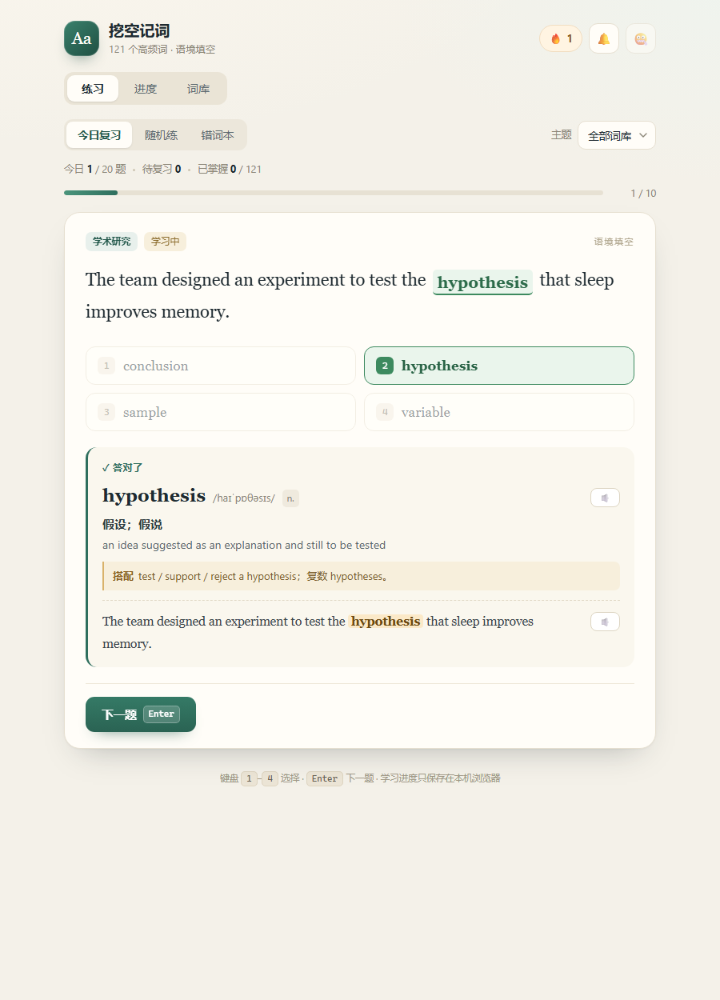
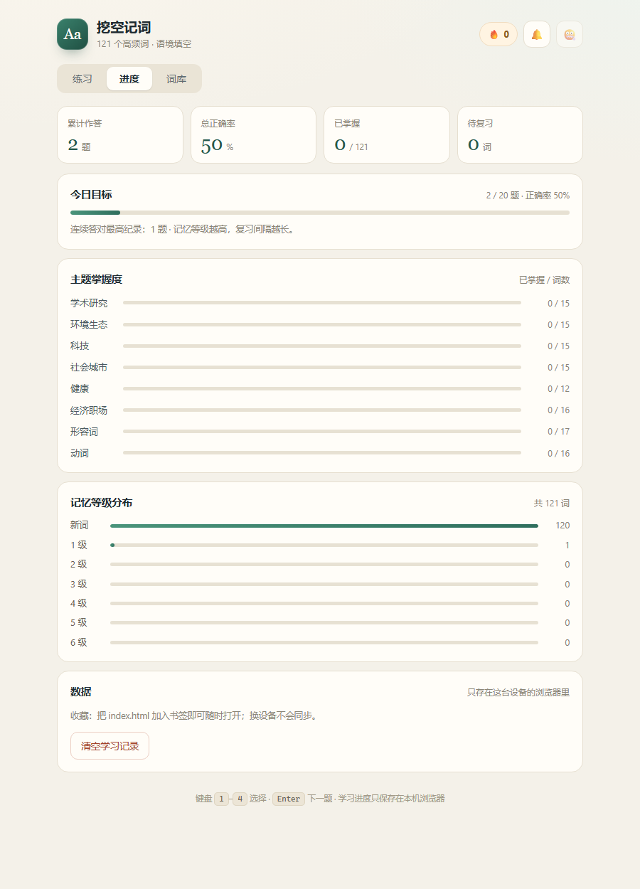
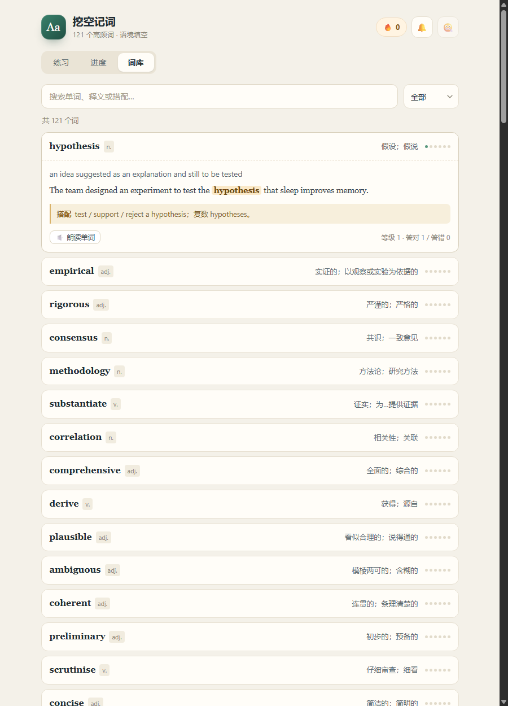
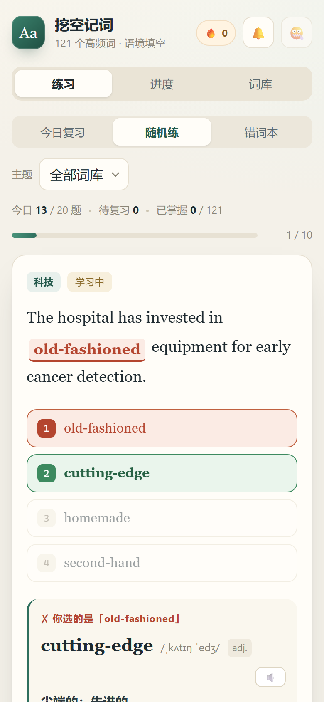

# 挖空记词 · IELTS 语境填空

**在线使用：[awahara.github.io/Awahara-s-vocabulary-2026](https://awahara.github.io/Awahara-s-vocabulary-2026/)**

一个零依赖的网页小应用：给出一个带空格的英文例句，从四个单词里选一个填进去，答完立刻看到词性、音标、中英释义、固定搭配和完整例句。

目标不是「背单词表」，而是在语境里反复遇见同一个词，把「这个词大概什么意思」变成「这个句子就该用这个词」。



## 直接使用

- **在线版**：打开 <https://awahara.github.io/Awahara-s-vocabulary-2026/>，手机电脑都能用
- **离线版**：双击 `index.html`，用浏览器打开即可。不需要安装、不需要联网、没有构建步骤

学习进度保存在浏览器的 localStorage 里，换设备不会同步。

## 功能

- **121 个雅思高频词**，按 8 个主题分组：学术研究、环境生态、科技、社会城市、健康、经济职场、形容词、动词
- **三种练习模式**
  - `今日复习`：按记忆曲线挑出到期该复习的词，再用新词补足一轮 10 题
  - `随机练`：从全部（或某个主题的）词里随机抽 10 题
  - `错词本`：自动收集答错过的词，按错误次数排序
- **即时反馈**：正确/错误高亮、词性、英式音标、中文释义、英文释义、搭配提示、完整例句，单词与整句都可以朗读
- **记忆等级与间隔复习**：每个词有 0–6 级，答对升级、答错降级；复习间隔为 10 分钟 → 1 → 2 → 4 → 8 → 16 → 32 天
- **进度页**：累计答题数、总正确率、今日目标、主题掌握度、记忆等级分布，可一键清空记录
- **词库页**：按单词 / 释义 / 搭配 / 主题搜索，按「未学 / 学习中 / 已掌握 / 错过的词」筛选，展开看例句
- **键盘操作**：`1`–`4` 选择选项，`Enter` 进入下一题
- **声音**：答对/答错音效、答对后自动朗读（都可在右上角开关），朗读使用系统自带语音
- 手机端单列布局，长单词自动换行

## 界面

练习与即时反馈：


进度页 / 词库页：





手机端：



## 目录结构

```
ielts-vocab/
├── index.html      页面骨架（练习 / 进度 / 词库三个视图）
├── styles.css      全部样式（暖纸色 + 深绿主色，句子用衬线体）
├── app.js          练习流程、记忆模型、进度统计、localStorage
├── data.js         词库（121 个词）
├── check-data.js   词库自检脚本（字段完整性、选项重复、空格数量等）
└── preview/        界面截图
```

## 加词 / 改词

所有内容都在 `data.js` 里，一个词一条：

```js
{
  w: "mitigate",                 // 原形
  p: "v.",                       // 词性
  ipa: "/ˈmɪtɪɡeɪt/",            // 音标
  cn: "缓解；减轻（不良影响）",     // 中文释义
  en: "to make something bad less serious", // 英文释义
  t: "环境生态",                  // 主题，必须是 IELTS_TOPICS 里的一个
  s: "Planting trees can help ____ the risk of flooding.", // 例句，____ 是空格
  o: ["decorate", "postpone", "exaggerate"], // 三个干扰项
  note: "mitigate the risk / impact；名词 mitigation。" // 搭配提示
}
```

几个约定：

- `____`（两个以上下划线）代表空格，每条例句只能有一个
- `o` 里写三个干扰项，前端会把它和正确答案一起打乱；干扰项最好与答案同词性、同语域，但**语义上只有答案成立**
- 如果答案在句中要变形（比如复数 `emissions`、过去式 `prompted`），加一个 `f` 字段写句中形式，选项会显示这个形式
- 空格在句首时，前端会自动把选项首字母大写

改完运行一次自检：

```bash
node check-data.js
```

它会检查字段缺失、单词重复、选项重复、空格数量、答案提前出现在句子里等问题。

## 记忆模型

每个词有一条记录：`{ b: 等级, r: 答对次数, w: 答错次数, seen: 上次作答时间, due: 下次到期时间 }`。

- 答对：等级 +1（最高 6 级），下次复习时间 = 当前 + `[0.05, 1, 2, 4, 8, 16, 32][等级]` 天
- 答错：等级 −1，10 分钟后重新出现
- 等级 ≥ 4 记为「已掌握」，出现在进度页的主题统计里

「今日复习」优先取已到期的词，不够 10 题就用没学过的新词补，再不够就取最近到期的词。所以每天打开都有题做，且旧词会按间隔回来。

## 说明

- 例句与释义为学习用途编写，音标采用英式；`check-data.js` 只做结构校验，语义是否严谨仍需人工把关
- 朗读依赖浏览器的 `speechSynthesis`，Chrome / Edge / Safari 支持；没有合适语音时会静默跳过
- 进度只存在当前浏览器；清理浏览器数据或换设备都会丢失
